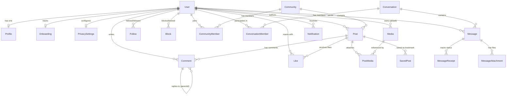

# POPPIN — Data Model Plan & Schema Analysis

<!-- redesign:data-model-plan v1.0.0 -->

## 1. Executive Summary & Schema Unification

This document details the complete data persistence model for POPPIN. It maps all entities, foreign key relationships, cascade behaviors, uniqueness constraints, and performance indexes required to support the monochromatic redesign, real-time messaging, community hubs, and high-velocity social feeds.

### Single Source of Truth
The canonical database is **PostgreSQL (Neon)**. The project previously suffered from schema fragmentation:
- `prisma/schema.prisma` was set to SQLite (`provider = "sqlite"`).
- `prisma/postgresql/schema.prisma` was configured for Neon PostgreSQL (`provider = "postgresql"`).

This duality created tooling confusion. Under this plan, **`prisma/postgresql/schema.prisma` is the sole production schema authority**, while `prisma/schema.prisma` is aligned directly to avoid developer confusion.

---

## 2. Entity-Relationship Overview



---

## 3. Entity Specification & Comparison with Existing Schema

### 3.1 Identity & Access Models

#### Model: `User`
- **Fields:**
  - `id`: `String @id @default(uuid())`
  - `email`: `String @unique`
  - `passwordHash`: `String?` (Nullable for OAuth-only accounts)
  - `googleId`: `String? @unique`
  - `tokenVersion`: `Int @default(1)` (Incremented for immediate session revocation)
  - `createdAt`: `DateTime @default(now())`
  - `updatedAt`: `DateTime @updatedAt`
- **Relations:** 1-to-1 with `Profile`, `Onboarding`, `PrivacySettings`; 1-to-many with posts, comments, likes, messages, memberships.
- **Audit Comparison:** Fully matches existing PostgreSQL schema. Durable and verified.

#### Model: `Profile`
- **Fields:**
  - `id`: `String @id @default(uuid())`
  - `userId`: `String @unique` (FK -> `User.id` with `onDelete: Cascade`)
  - `username`: `String @unique` (Clean alphanumeric handle: `^[a-z0-9_]{3,30}$`)
  - `displayName`: `String?`
  - `bio`: `String?` (Max 160 characters)
  - `headline`: `String?` (Professional role/title)
  - `avatar`: `String?` (Cloudinary URL)
  - `banner`: `String?` (Cloudinary cover photo URL)
  - `location`: `String?`
  - `website`: `String?`
  - `github`: `String?`
  - `twitter`: `String?`
  - `linkedin`: `String?`
  - `skills`: `String @default("[]")` (JSON array of strings)
  - `interests`: `String @default("[]")` (JSON array of strings)
  - `isPublic`: `Boolean @default(true)`
  - `createdAt`: `DateTime @default(now())`
  - `updatedAt`: `DateTime @updatedAt`
- **Audit Comparison:** Fully matches existing PostgreSQL schema. Verified.

#### Model: `Onboarding`
- **Fields:**
  - `id`: `String @id @default(uuid())`
  - `userId`: `String @unique` (FK -> `User.id` with `onDelete: Cascade`)
  - `isCompleted`: `Boolean @default(false)`
  - `currentStep`: `String @default("STEP_1")`
  - `completedSteps`: `String @default("[]")` (JSON array)
  - `role`: `String?`
  - `headline`: `String?`
  - `selectedSkills`: `String @default("[]")`
  - `selectedInterests`: `String @default("[]")`
- **Audit Comparison:** Existing schema matches. Provides non-blocking progressive onboarding state.

---

### 3.2 Social Graph & Safety Models

#### Model: `Follow`
- **Fields:**
  - `id`: `String @id @default(uuid())`
  - `followerId`: `String` (FK -> `User.id`)
  - `followingId`: `String` (FK -> `User.id`)
  - `createdAt`: `DateTime @default(now())`
- **Constraints & Indexes:**
  - `@@unique([followerId, followingId])`
  - `@@index([followerId])`
  - `@@index([followingId])`

#### Model: `Block` & `UserReport`
- **Block Constraints:** `@@unique([blockerId, blockedId])`. Enforced bidirectionally across messaging and feed queries.
- **Audit Comparison:** Fully present in PostgreSQL.

---

### 3.3 Content & Feed Models

#### Model: `Post`
- **Fields:**
  - `id`: `String @id @default(uuid())`
  - `authorId`: `String` (FK -> `User.id` with `onDelete: Cascade`)
  - `communityId`: `String?` (FK -> `Community.id` with `onDelete: SetNull`)
  - `content`: `String` (Text body, markdown supported)
  - `type`: `String @default("TEXT")` (`TEXT`, `MEDIA`, `LINK`, `CODE`)
  - `links`: `String @default("[]")` (JSON string array)
  - `tags`: `String @default("[]")` (JSON string array of hashtags)
  - `createdAt`: `DateTime @default(now())`
  - `updatedAt`: `DateTime @updatedAt`
- **Proposed Index Optimization:**
  - `@@index([createdAt(sort: Desc), id])` (Critical for cursor-based pagination)
  - `@@index([authorId, createdAt(sort: Desc)])`
  - `@@index([communityId, createdAt(sort: Desc)])`

#### Model: `Comment`
- **Fields:**
  - `id`: `String @id @default(uuid())`
  - `userId`: `String` (FK -> `User.id`)
  - `postId`: `String` (FK -> `Post.id` with `onDelete: Cascade`)
  - `parentId`: `String?` (FK -> `Comment.id` with `onDelete: Cascade` for threaded replies)
  - `content`: `String`
  - `createdAt`: `DateTime @default(now())`
  - `updatedAt`: `DateTime @updatedAt`
- **Indexes:**
  - `@@index([postId, createdAt(sort: Asc)])`
  - `@@index([parentId])`

#### Model: `Like` & `SavedPost`
- **Unique Constraints:** `@@unique([userId, postId])` on both models.

---

### 3.4 Community Models

#### Model: `Community`
- **Fields:**
  - `id`: `String @id @default(uuid())`
  - `slug`: `String @unique` (URL slug: `^[a-z0-9-]{3,50}$`)
  - `name`: `String`
  - `tagline`: `String?`
  - `description`: `String?`
  - `category`: `String @default("General")` (`Engineering`, `Design`, `AI`, `Founders`, `General`)
  - `avatar`: `String?`
  - `coverImage`: `String?`
  - `isPrivate`: `Boolean @default(false)`
  - `rules`: `String @default("[]")` (JSON array of strings)
  - `createdById`: `String` (FK -> `User.id`)
  - `createdAt`: `DateTime @default(now())`
  - `updatedAt`: `DateTime @updatedAt`

#### Model: `CommunityMember`
- **Fields:**
  - `id`: `String @id @default(uuid())`
  - `communityId`: `String` (FK -> `Community.id` with `onDelete: Cascade`)
  - `userId`: `String` (FK -> `User.id` with `onDelete: Cascade`)
  - `role`: `String @default("MEMBER")` (`ADMIN`, `MODERATOR`, `MEMBER`)
  - `joinedAt`: `DateTime @default(now())`
- **Constraints:** `@@unique([communityId, userId])`

---

### 3.5 Real-Time Messaging Models (Socket.IO)

#### Model: `Conversation`
- **Fields:**
  - `id`: `String @id @default(uuid())`
  - `type`: `String @default("DIRECT")` (`DIRECT` or `GROUP`)
  - `title`: `String?` (Group conversation title)
  - `createdById`: `String?` (FK -> `User.id`)
  - `createdAt`: `DateTime @default(now())`
  - `updatedAt`: `DateTime @updatedAt`

#### Model: `ConversationMember`
- **Fields:**
  - `id`: `String @id @default(uuid())`
  - `conversationId`: `String` (FK -> `Conversation.id` with `onDelete: Cascade`)
  - `userId`: `String` (FK -> `User.id` with `onDelete: Cascade`)
  - `role`: `String @default("MEMBER")` (`ADMIN`, `MEMBER`)
  - `lastReadMessageId`: `String?` (Tracks read cursor)
  - `joinedAt`: `DateTime @default(now())`
  - `updatedAt`: `DateTime @updatedAt`
- **Constraints:** `@@unique([conversationId, userId])`

#### Model: `Message`
- **Fields:**
  - `id`: `String @id @default(uuid())`
  - `conversationId`: `String` (FK -> `Conversation.id` with `onDelete: Cascade`)
  - `senderId`: `String` (FK -> `User.id`)
  - `clientMessageId`: `String?` (Client-generated UUID for idempotent deduplication)
  - `content`: `String`
  - `type`: `String @default("TEXT")` (`TEXT`, `IMAGE`, `VIDEO`, `FILE`)
  - `deletedAt`: `DateTime?` (Soft delete timestamp)
  - `createdAt`: `DateTime @default(now())`
  - `updatedAt`: `DateTime @updatedAt`
- **Constraints & Indexes:**
  - `@@unique([senderId, clientMessageId])` (Prevents duplicate messages on network retry)
  - `@@index([conversationId, createdAt(sort: Asc)])`

#### Model: `MessageReceipt` & `MessageAttachment`
- **Receipts:** Tracks `status` (`SENT`, `DELIVERED`, `READ`) per user with timestamps `deliveredAt` and `readAt`.
- **Attachments:** Cloudinary asset metadata (`url`, `type`, `fileName`, `fileSize`, `publicId`).

---

### 3.6 Media & Notification Models

#### Model: `Media` & `PostMedia`
- Stores verified Cloudinary uploads (`publicId`, `url`, `mimeType`, `size`, `resourceType`, `width`, `height`).

#### Model: `Notification`
- **Fields:**
  - `id`: `String @id @default(uuid())`
  - `recipientId`: `String` (FK -> `User.id` with `onDelete: Cascade`)
  - `actorId`: `String` (FK -> `User.id`)
  - `type`: `String` (`LIKE`, `COMMENT`, `REPLY`, `FOLLOW`, `COMMUNITY_INVITE`, `MESSAGE`)
  - `entityId`: `String?`
  - `entityType`: `String?`
  - `message`: `String`
  - `isRead`: `Boolean @default(false)`
  - `readAt`: `DateTime?`
  - `metadata`: `String?` (JSON object)
  - `createdAt`: `DateTime @default(now())`
- **Indexes:**
  - `@@index([recipientId, isRead, createdAt(sort: Desc)])`

---

## 4. Required Schema Enhancements

To achieve high-efficiency cursor pagination and zero-lag indexing, the following additive indexes are designated for Phase 2:

```prisma
// Enhancements to prisma/postgresql/schema.prisma:

model Post {
  // ... existing fields ...
  @@index([createdAt(sort: Desc), id])
  @@index([authorId, createdAt(sort: Desc)])
  @@index([communityId, createdAt(sort: Desc)])
}

model Notification {
  // ... existing fields ...
  @@index([recipientId, isRead, createdAt(sort: Desc)])
}
```

No models are duplicated; existing table names and relationships are strictly preserved.

