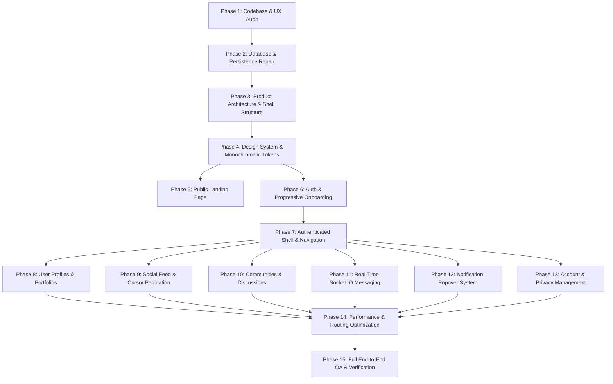

# POPPIN — Phased Engineering & Product Redesign Implementation Plan

<!-- redesign:implementation-plan v1.0.0 -->

## 1. Overview & Execution Strategy

This implementation plan defines the complete end-to-end execution roadmap for transforming POPPIN into a production-grade, monochromatic, playful yet professional social networking platform.

The plan rigorously adheres to the 15-phase execution sequence mandated by the project specifications. In accordance with architectural principles, **database persistence and backend reliability precede frontend development**. No UI feature is constructed on top of mock data or unverified persistence.

---

## 2. Phase-by-Phase Specification

---

### Phase 1: Existing Codebase & UX Audit
- **Objective:** Establish an exhaustive baseline audit of architecture, dependencies, Prisma schemas, broken paths, mock data usages, and UX inconsistencies.
- **Scope:** Complete project scan (`app/`, `components/`, `lib/`, `prisma/`, `services/`, `realtime-server/`).
- **Files Affected:** `docs/redesign/*`, `tests/audit-db.ts`.
- **Dependencies:** None.
- **Database Changes:** None.
- **API Changes:** None.
- **Frontend Changes:** None.
- **Testing Strategy:** Scripted table reflection on Neon PostgreSQL, dependency audit, route enumeration.
- **Acceptance Criteria:** All 7 planning documents compiled and aligned with installed design skills.
- **Risks:** Unidentified hidden assumptions in legacy code.
- **Complexity:** Low-Medium.
- **Completion Definition:** Planning documentation delivered, reviewed, and approved.

---

### Phase 2: Database & Persistence Repair
- **Objective:** Eliminate mock data reliance, synchronize Prisma schema definitions, establish automated PostgreSQL seeding, and guarantee 100% durable persistence.
- **Scope:**
  - Consolidate primary Prisma schema to PostgreSQL (`prisma/postgresql/schema.prisma`).
  - Eliminate split-brain SQLite vs PostgreSQL generator confusion.
  - Create a production-grade database seed script (`scripts/seed-postgresql.ts`) creating real initial users, profiles, communities, and posts.
  - Verify Cloudinary metadata persistence in `Media` and `PostMedia`.
- **Files Likely to be Affected:**
  - `prisma/postgresql/schema.prisma`
  - `prisma/schema.prisma`
  - `package.json`
  - `scripts/seed-postgresql.ts`
  - `lib/db.ts`
  - `tests/db-persistence.test.ts`
- **Dependencies:** Phase 1.
- **Database Changes:**
  - Add missing composite index on `Post` for `[createdAt(sort: Desc), id]` to enable high-efficiency cursor-based pagination.
  - Verify foreign key cascades on `CommunityMember`, `Comment`, and `Like`.
- **API Changes:** Verify all repository queries connect through pooled Neon connection.
- **Frontend Changes:** None.
- **Testing Strategy:** Automated integration test asserting write-and-read durability across `User`, `Profile`, `Post`, `Comment`, `Community`, `Message`.
- **Acceptance Criteria:** Seed script populates Neon PostgreSQL; queries return real data; zero references to `lib/mock-communities.ts`.
- **Risks:** Migration collisions on live database. (Mitigated by additive migrations via `prisma migrate diff`).
- **Complexity:** High.
- **Completion Definition:** Live database seeded and verified by test suite.

---

### Phase 3: Product Architecture & Shell Structure
- **Objective:** Restructure application routing into two distinct shell states: Public Shell vs. Authenticated Shell.
- **Scope:**
  - Public shell for unauthenticated users (Landing, Login, Register, Forgot Password).
  - Authenticated shell with persistent left navigation sidebar and topbar for authenticated routes (`/feed`, `/communities`, `/messages`, `/profile`, `/settings`).
  - Server-side middleware authentication and deterministic routing.
- **Files Likely to be Affected:**
  - `middleware.ts`
  - `app/layout.tsx`
  - `app/(public)/layout.tsx` (or route group restructuring)
  - `app/(authenticated)/layout.tsx`
  - `context/AuthContext.tsx`
  - `components/Navbar.tsx` (refactored / split)
- **Dependencies:** Phase 2.
- **Database Changes:** None.
- **API Changes:** Synchronize session verification in `middleware.ts` reading HTTP-only `poppin_token` cookie.
- **Frontend Changes:** Separate public navbar from authenticated application shell.
- **Testing Strategy:** Verify unauthenticated redirect to `/login` for protected routes; verify authenticated redirect to `/feed` when visiting `/login`.
- **Acceptance Criteria:** No flash of unauthenticated content; zero redirect loops.
- **Risks:** Cookie domain or SameSite mismatches during local testing.
- **Complexity:** Medium-High.
- **Completion Definition:** Distinct public and authenticated layouts active and verified.

---

### Phase 4: Design System & Monochromatic Tokens
- **Objective:** Implement the monochromatic black-and-white design system tokens in Tailwind and create core reusable UI components.
- **Scope:**
  - Update `tailwind.config.ts` with canvas (`#FCFBF9`), surface (`#FFFFFF`), neutral borders (`#E4E4E7`), and text tokens (`#09090B`, `#18181B`, `#71717A`).
  - Configure fonts: Plus Jakarta Sans (body) and Unbounded (display headings).
  - Build core atom components: `Button`, `Input`, `Textarea`, `Card`, `Badge`, `Avatar`, `Dialog`, `Dropdown`, `Skeleton`.
  - Ban all random emojis and emojis-as-icons; standardize on Lucide React (1.75–1.85 stroke).
- **Files Likely to be Affected:**
  - `tailwind.config.ts`
  - `app/globals.css`
  - `components/ui/*`
- **Dependencies:** Phase 3.
- **Database Changes:** None.
- **API Changes:** None.
- **Frontend Changes:** Universal design tokens and accessible component library.
- **Testing Strategy:** Component visual verification across desktop (1440px), tablet (768px), and mobile (390px).
- **Acceptance Criteria:** Strict monochrome compliance; contrast ratios ≥ 4.5:1; zero gradient text.
- **Complexity:** Medium.
- **Completion Definition:** Component primitives built and available in `components/ui/`.

---

### Phase 5: Public Landing Page
- **Objective:** Build a high-craft, persuasive public landing page on `/` communicating product value immediately.
- **Scope:**
  - Hero headline in Unbounded typography.
  - Interactive live handle availability checker.
  - Social proof and real product UI previews (Taste-Skill mandate: real product interfaces, no empty grounds).
  - Feature highlights (Identity, Feeds, Communities, Real-Time Chat).
  - Dual working CTAs: **Get Started** (`/register`) and **Login** (`/login`).
  - Polished minimalist footer.
- **Files Likely to be Affected:**
  - `app/page.tsx`
  - `components/landing/*`
- **Dependencies:** Phase 4.
- **Database Changes:** None.
- **API Changes:** Optimize `/api/v1/usernames/availability` endpoint response latency.
- **Frontend Changes:** Redesign `app/page.tsx` adhering to Taste-Skill and Impeccable standards.
- **Testing Strategy:** End-to-end CTA tests; handle availability probe latency check.
- **Acceptance Criteria:** Single-screen hero; working CTAs; responsive collapse to mobile viewports.
- **Complexity:** Medium.
- **Completion Definition:** Landing page deployed with live handle checker and responsive layout.

---

### Phase 6: Authentication & Progressive Onboarding
- **Objective:** Fix authentication transitions, slow redirects, and streamline the onboarding flow to collect minimum essential information.
- **Scope:**
  - Redesign `/login` and `/register` with monochromatic styling and clear validation errors.
  - 6-step progressive onboarding flow:
    1. Account creation & verified username claim.
    2. Display name & title.
    3. Profile picture upload via Cloudinary.
    4. Short bio (max 160 chars).
    5. Technical skills & interests tagging.
    6. Community discovery & join suggestions.
  - Non-blocking "Skip for now" options on optional steps.
- **Files Likely to be Affected:**
  - `app/login/page.tsx`
  - `app/register/page.tsx`
  - `app/onboarding/page.tsx`
  - `services/onboarding.service.ts`
  - `services/auth.service.ts`
- **Dependencies:** Phase 4, Phase 2.
- **Database Changes:** Ensure `Onboarding` model status transitions (`STEP_1`, `STEP_2`, `COMPLETED`).
- **API Changes:** Streamlined onboarding completion endpoint.
- **Frontend Changes:** Step wizard with state preservation and Cloudinary image upload.
- **Testing Strategy:** Registration to onboarding to feed completion flow verification.
- **Acceptance Criteria:** New user completes onboarding in under 60 seconds; deterministic redirect to `/feed`.
- **Complexity:** Medium-High.
- **Completion Definition:** Auth and onboarding flows tested and functional.

---

### Phase 7: Authenticated Shell & Navigation
- **Objective:** Construct the persistent left navigation sidebar and top application bar for all authenticated routes.
- **Scope:**
  - **Left Sidebar:**
    - Brand logo.
    - Primary Navigation: **Home** (`/feed`), **Communities** (`/communities`), **Messages** (`/messages`).
    - Collapsible "My Communities" list with quick switching.
    - Quick actions: "Create Community".
    - User profile card and account settings link.
    - Collapsible on tablet/mobile with mobile navigation drawer.
  - **Top Application Bar:**
    - Universal search bar (Cmd+K).
    - Notification bell with unread badge and dropdown popover (NOT a sidebar tab).
    - "Create Post" modal trigger button.
    - User avatar and account dropdown.
- **Files Likely to be Affected:**
  - `components/layout/AppSidebar.tsx`
  - `components/layout/AppTopbar.tsx`
  - `components/layout/AuthenticatedLayout.tsx`
  - `app/(main)/layout.tsx`
- **Dependencies:** Phase 4, Phase 6.
- **Database Changes:** Query user's joined communities for sidebar display.
- **API Changes:** Endpoint `/api/v1/users/me/communities` for quick sidebar hydration.
- **Frontend Changes:** Responsive shell wrapping main content.
- **Testing Strategy:** Breakpoint resize tests (390px, 768px, 1024px, 1440px).
- **Acceptance Criteria:** Sidebar persists across route transitions; notifications open in popover.
- **Complexity:** High.
- **Completion Definition:** Authenticated shell operational across all main pages.

---

### Phase 8: User Profiles & Portfolios
- **Objective:** Deliver expressive, persistent user portfolio profiles displaying projects, skills, communities, and posts.
- **Scope:**
  - Own profile view (`/profile`) and public profile view (`/profiles/[username]`).
  - Avatar and cover photo upload via Cloudinary with instant database persistence.
  - Profile tabs: **Posts**, **Communities**, **Skills & Links**, **About**.
  - Follow/Unfollow action with real-time counter updates.
  - User block and report actions.
- **Files Likely to be Affected:**
  - `app/profile/page.tsx`
  - `app/profiles/[username]/page.tsx`
  - `components/profile/*`
  - `services/profile.service.ts`
- **Dependencies:** Phase 7, Phase 2.
- **Database Changes:** None (schema already supports all profile fields).
- **API Changes:** Optimized profile query including follower status and joined communities.
- **Frontend Changes:** Redesigned profile header, bio editor, and tabbed portfolio content.
- **Testing Strategy:** Profile update persistence test; Cloudinary upload test.
- **Acceptance Criteria:** Edited profile saves to PostgreSQL immediately; public profile renders correctly.
- **Complexity:** Medium-High.
- **Completion Definition:** Profile surfaces redesigned and verified.

---

### Phase 9: Social Feed & Cursor Pagination
- **Objective:** Build an Instagram/X-inspired social feed with multimedia posts, genuine cursor pagination, and inline threaded comments.
- **Scope:**
  - Feed timeline supporting text posts, single/multi-image posts, and code snippets.
  - Cloudinary-backed media rendering with responsive aspect ratios and lightbox zoom.
  - Real cursor-based infinite scrolling (`cursor = post.id`, `limit = 10`) using `IntersectionObserver`.
  - Inline comment section expanding directly below each post card (no separate page).
  - Threaded comment replies and instant like/bookmark toggles.
- **Files Likely to be Affected:**
  - `app/(main)/feed/page.tsx`
  - `components/feed/*`
  - `components/posts/*`
  - `services/feed.service.ts`
  - `services/post.service.ts`
- **Dependencies:** Phase 7, Phase 2.
- **Database Changes:** Composite index `@@index([createdAt, id])` on `Post`.
- **API Changes:** Efficient cursor pagination in `/api/v1/feed` and `/api/v1/posts/[postId]/comments`.
- **Frontend Changes:** Feed list with loading skeletons, empty state, and inline comment drawer.
- **Testing Strategy:** Infinite scroll test with 50+ posts; inline comment creation and reply test.
- **Acceptance Criteria:** Zero layout jumps; comments expand inline; infinite scroll loads next batch smoothly.
- **Complexity:** High.
- **Completion Definition:** Production-ready feed with inline comments operational.

---

### Phase 10: Communities & Discussions
- **Objective:** Implement Reddit-style community hubs with structured discussions, roles, and WhatsApp-style membership.
- **Scope:**
  - Community Hub index (`/communities`): discovery, search by category, trending hubs.
  - Community Detail (`/communities/[slug]`): banner, avatar, title, description, rules, member count.
  - Membership toggle: **Join** / **Leave** with instant membership state update.
  - Community-scoped post creation and discussions.
  - Admin/Moderator badges and management actions.
  - Complete elimination of `lib/mock-communities.ts`.
- **Files Likely to be Affected:**
  - `app/communities/page.tsx`
  - `app/communities/[slug]/page.tsx`
  - `components/communities/*`
  - `services/community.service.ts`
  - `repositories/community.repository.ts`
- **Dependencies:** Phase 7, Phase 2.
- **Database Changes:** Verify `CommunityMember` roles (`ADMIN`, `MODERATOR`, `MEMBER`).
- **API Changes:** Clean REST endpoints for community details, membership, and community posts.
- **Frontend Changes:** Fully redesigned community layout with sidebar quick-access.
- **Testing Strategy:** Community creation, joining, and community-filtered feed tests.
- **Acceptance Criteria:** Real database persistence for all community data; mock files deleted.
- **Complexity:** High.
- **Completion Definition:** Communities feature functional and integrated into sidebar.

---

### Phase 11: Real-Time Socket.IO Messaging
- **Objective:** Connect the frontend to the dedicated Socket.IO server on `http://localhost:4000` for 1-on-1 and group conversations.
- **Scope:**
  - Global `SocketProvider` wrapping the authenticated application shell.
  - Chat window supporting conversation list, real-time message stream, optimistic delivery, and auto-scroll.
  - Multi-device active presence indicators (green dot), typing bubbles with 4s auto-expiry, and read receipts.
  - Media attachment uploads directly through Cloudinary signed flow.
  - Group conversation creation and participant list.
- **Files Likely to be Affected:**
  - `app/(main)/messages/page.tsx`
  - `components/messaging/*`
  - `lib/socket/client.ts`
  - `context/SocketContext.tsx`
  - `realtime-server/src/*` (already running and tested)
- **Dependencies:** Phase 7, Phase 2.
- **Database Changes:** None (schema and migrations already applied).
- **API Changes:** Conversation listing and message history sync.
- **Frontend Changes:** Responsive chat layout; unread conversation badges in sidebar.
- **Testing Strategy:** Multi-browser socket messaging test (presence, typing, instant delivery).
- **Acceptance Criteria:** Messages persist to PostgreSQL before broadcast; real-time latency < 100ms.
- **Complexity:** High.
- **Completion Definition:** 1-on-1 and group messaging fully operational.

---

### Phase 12: Notification Popover System
- **Objective:** Deliver a real-time notification dropdown in the top application bar (likes, comments, follows, mentions).
- **Scope:**
  - Topbar bell icon with unread count badge.
  - Popover dropdown showing notification items with actor avatars, timestamps, and target links.
  - "Mark as read" and "Mark all as read" actions.
  - Real-time notification updates triggered via Socket.IO events.
  - Notice: No dedicated primary sidebar navigation tab for notifications.
- **Files Likely to be Affected:**
  - `components/notifications/NotificationBell.tsx`
  - `components/notifications/NotificationDropdown.tsx`
  - `services/notification.service.ts`
  - `app/api/v1/notifications/*`
- **Dependencies:** Phase 7, Phase 11.
- **Database Changes:** Index on `Notification` `[recipientId, isRead, createdAt]`.
- **API Changes:** Streamlined notification batch read endpoint.
- **Frontend Changes:** Topbar popover with infinite scroll or pagination.
- **Testing Strategy:** Trigger like/comment/follow actions and verify bell badge updates in real-time.
- **Acceptance Criteria:** Unread count decrements on click; popover closes on outside click.
- **Complexity:** Medium.
- **Completion Definition:** Notification bell system functional in topbar.

---

### Phase 13: Account & Privacy Management
- **Objective:** Redesign the account settings into a structured, tabbed settings interface.
- **Scope:**
  - Settings tabs: **Profile Information**, **Security & Password**, **Privacy & Visibility**, **Blocked Users**, **Danger Zone**.
  - Username change with live availability check.
  - Password update with token invalidation.
  - Privacy toggles: public/private profile, message permissions.
  - Blocked users management (unblock action).
  - Account deletion with double-confirmation modal and cascade cleanup.
- **Files Likely to be Affected:**
  - `app/settings/page.tsx`
  - `components/settings/*`
  - `services/account.service.ts`
- **Dependencies:** Phase 7, Phase 2.
- **Database Changes:** Cascade verification on account deletion.
- **API Changes:** Settings update endpoints.
- **Frontend Changes:** Clean tabbed settings view with feedback toasts.
- **Testing Strategy:** Password change test; account deletion test with data cleanup check.
- **Acceptance Criteria:** Confirmation modal prevents accidental deletion; all settings persist.
- **Complexity:** Medium.
- **Completion Definition:** Account management suite redesigned and verified.

---

### Phase 14: Performance & Routing Optimization
- **Objective:** Maximize application responsiveness, eliminate hydration mismatches, optimize bundle sizes, and eliminate redundant requests.
- **Scope:**
  - Convert static layout components to React Server Components.
  - Implement Next.js `Image` with responsive blur placeholders for Cloudinary assets.
  - Cache deduplication using SWR or React Query patterns for repetitive API calls.
  - Code splitting and dynamic imports for heavy dialogs and media uploaders.
  - Optimize Socket.IO connection lifecycle to ensure a single singleton connection across the shell.
- **Files Likely to be Affected:**
  - `app/*`
  - `next.config.ts`
  - `lib/api-client.ts`
- **Dependencies:** All previous phases.
- **Database Changes:** Query optimization with `select` projections.
- **API Changes:** Cache-Control headers for public assets.
- **Frontend Changes:** Lazy loading, skeleton states.
- **Testing Strategy:** Lighthouse audit, React DevTools profiling, bundle analyzer.
- **Acceptance Criteria:** Lighthouse Performance score ≥ 90; Largest Contentful Paint (LCP) < 1.8s; zero console warnings.
- **Complexity:** Medium-High.
- **Completion Definition:** Performance benchmarks achieved and documented.

---

### Phase 15: Full End-to-End QA & Verification
- **Objective:** Conduct exhaustive manual and automated quality assurance across all user journeys, browsers, and viewport sizes.
- **Scope:** Complete verification against `docs/redesign/QA_CHECKLIST.md`.
- **Files Likely to be Affected:** `tests/*`, bug fix targets.
- **Dependencies:** Phase 1 through Phase 14.
- **Database Changes:** None.
- **API Changes:** None.
- **Frontend Changes:** Bug fixes and edge-case hardening.
- **Testing Strategy:** Automated integration test suite (`npm run test`), real-time socket suite (`npm run realtime:test`), cross-browser testing (Chrome, Safari, Firefox, Edge).
- **Acceptance Criteria:** 100% of checklist items passed; zero regressions; zero console errors.
- **Complexity:** Medium.
- **Completion Definition:** Final sign-off and deployment readiness report.

