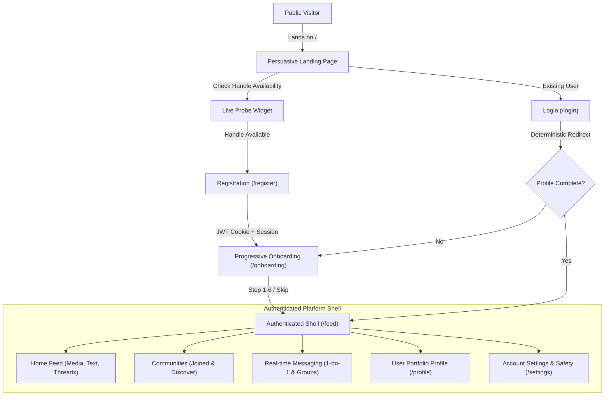

# POPPIN — Product Vision & Strategic Specification

<!-- redesign:product-vision v1.0.0 -->

## 1. Executive Summary & Core Objective

POPPIN is a social identity and community platform engineered specifically for **creative builders, developers, designers, and tech innovators**. It transforms digital presence from static, resume-style bullet points into a dynamic, live, and expressive portfolio ecosystem.

The redesign resolves fragmented experiences, disparate visual styling, and broken persistence by establishing an original, unified product identity that synthesises four distinct interaction paradigms:
1. **Instagram-style Social Feeds & Individual Messaging:** High-fidelity media presentations, personal creative expressions, fluid lightbox interactions, and direct peer conversations.
2. **Reddit-style Communities & Discussions:** Topic-focused community hubs, transparent moderation, nested inline discussion threads, and collective curation.
3. **WhatsApp-style Group Organisation & Conversations:** Low-latency real-time group communication, presence indicators, typing feedback, delivery/read receipts, and lightweight media sharing.
4. **X-style Text & Media Content Timelines:** Rapid, chronological and algorithmic idea broadcasting, lightweight commentary, hashtags, and real-time public discourse.

POPPIN does not clone any of these services. Instead, it weaves their most effective interaction primitives into a cohesive, high-craft platform anchored by an authenticated application shell and a monochromatic, sophisticated design language.

---

## 2. Target User Personas

### Persona A: The Creative Coder / Indie Hacker ("Devon")
- **Role & Background:** Full-stack engineer, indie software developer, or open-source contributor.
- **Pain Point:** Traditional developer portfolios are static and isolated; LinkedIn feels corporate and sterile; GitHub showcases commits but not the lived experience or visual product craft; Discord chats get buried.
- **Goals in POPPIN:**
  - Claim a clean, verifiable builder handle (`@devon`).
  - Publish project devlogs, technical decisions, and architecture diagrams directly to builder feeds.
  - Create and moderate dedicated niche tech communities (e.g., `#distributed-systems`, `#generative-agents`).
  - Collaborate in real-time with peers through 1-on-1 and group messaging.

### Persona B: The Product & Interaction Designer ("Maya")
- **Role & Background:** UI/UX architect, motion designer, design engineer.
- **Pain Point:** Dribbble/Behance are passive image galleries without authentic technical discussions or working real-time communities; corporate feeds compress and diminish interface nuance.
- **Goals in POPPIN:**
  - Showcase high-fidelity UI components, interaction design clips, and design system tokens.
  - Engage in threaded, inline design critiques without leaving the feed.
  - Network with founders and engineers looking for design partners.

### Persona C: The Tech Community Lead / Founder ("Arjun")
- **Role & Background:** Startup founder, open-source maintainer, or technology community organiser.
- **Pain Point:** Managing fragmented audiences across Slack, X, and newsletters; losing engagement between asynchronous announcements and synchronous discussions.
- **Goals in POPPIN:**
  - Establish a community space with distinct branding, guidelines, and discussions.
  - Coordinate real-time group chats for core contributors and community initiatives.
  - Broadcast updates to followers with guaranteed persistence and delivery.

---

## 3. Product Positioning & Value Proposition

| Dimension | Corporate Networks (LinkedIn) | Ephemeral Chat (Discord / WhatsApp) | Public Microblogging (X) | **POPPIN** |
| :--- | :--- | :--- | :--- | :--- |
| **Primary Identity** | Resume, employment history, corporate accolades | Pseudonymous avatar, fleeting chat status | Handle, short bio, follower count | **Creative Builder Identity:** Verified skills, live project handles, social proof, portfolio links |
| **Content Discovery** | Algorithmic corporate milestones & recruiter posts | Siloed behind invite-only guild servers | High-velocity public timeline, rage-bait | **Curated Builder Feeds:** Tech updates, project showcases, devlogs, media previews |
| **Community Structure** | Inactive corporate groups | High-noise Discord channels | "Communities" bolted onto global feeds | **Dedicated Community Hubs:** Structured topics, rules, moderators, community-scoped feeds |
| **Messaging Integration**| Clunky asynchronous InMail | Synchronous chat isolated from public profile | Direct messages separated from group work | **Native Real-Time Messaging:** Socket.IO 1-on-1 & groups woven directly into the social workflow |
| **Visual Aesthetic** | Cluttered enterprise blue/gray | Dark gamer aesthetic or plain chat bubbles | Crowded timeline with ads and promoted trends | **Refined Monochromatic Craft:** Black-and-white, generous whitespace, zero visual slop |

---

## 4. Core User Journeys

### Journey 1: Landing to Active Builder
1. **Discovery:** Visitor lands on `/`. The hero presents an immediate, clear statement of what POPPIN is, accompanied by a live interactive handle probe.
2. **Registration:** Visitor tests a handle (`@alex`), gets instantaneous availability feedback, clicks **Get Started**, and enters email/password.
3. **Onboarding:** Progressive 6-step flow collects display name, avatar via Cloudinary, short bio, technical skills, and initial community suggestions. Steps are intuitive and non-blocking.
4. **First Feed Impression:** User lands on `/feed` inside the authenticated shell, populated with real posts from suggested builders and communities.

### Journey 2: Social Expression & Media Sharing
1. **Creation:** User clicks **Create Post** in the top navigation bar or inline feed composer.
2. **Composition:** User writes markdown-supported text, selects tags, and uploads high-resolution media (images/video) directly to Cloudinary with real-time progress.
3. **Persistence:** Post is saved in PostgreSQL, Cloudinary metadata linked, and the feed updates optimistically without reload.
4. **Community Engagement:** Peers interact via instant likes, bookmarks, and inline threaded comments with zero page jumps.

### Journey 3: Real-Time Community & Group Conversations
1. **Community Discovery:** User navigates to `/communities`, browses structured topics (Engineering, Design, AI, Founders), and joins a community.
2. **Group Transition:** Inside the community or messaging view, the user launches or joins a real-time conversation.
3. **Real-Time Exchange:** Powered by the dedicated Socket.IO server on `localhost:4000`, users experience instant message delivery, multi-device presence, typing bubbles, and read receipts.

---

## 5. Feature Boundaries & Non-Goals

### What POPPIN IS:
- A high-craft social platform uniting identity portfolios, media feeds, community forums, and instant messaging.
- A deterministic, reliable web application backed by PostgreSQL (Neon) and independent Socket.IO real-time services.
- A monochromatic, content-first visual environment prioritizing typography (Plus Jakarta Sans + Unbounded), clean layouts, and Lucide SVG iconography.

### What POPPIN IS NOT (Explicit Non-Goals):
- **Not a generic corporate job board:** No recruiter search filters, job application tracking systems, or corporate endorsement spam.
- **Not an ephemeral story-clone:** No 24-hour expiring status stories or disappearing picture bubbles.
- **Not an algorithmic engagement trap:** No "Trending Politics", no sponsored post spam, no fake click-count gamification.
- **Not an in-memory toy:** Every post, comment, message, reaction, and profile change MUST be durable in PostgreSQL.

---

## 6. Durable Product Principles

1. **Identity Over Vanity:** Profiles are expressive, technical digital homes that showcase real work, code, designs, and communities, not vanity metrics.
2. **Monochrome Precision:** Color belongs to user content and media. The chrome remains quiet, disciplined, and strictly monochromatic (black, warm off-white, crisp white, charcoal).
3. **Zero-Friction Transitions:** Navigation is fast and deterministic. No loading spinners over the entire screen; no redirect loops; no jarring page reloads.
4. **Synchronous Speed + Asynchronous Depth:** Feed posts allow thoughtful asynchronous reading and discussion; chat provides instantaneous synchronous collaboration.
5. **Radical Reliability:** If an action completes on screen, it is guaranteed to be saved in PostgreSQL. No fake UI optimistic lies that vanish on refresh.

